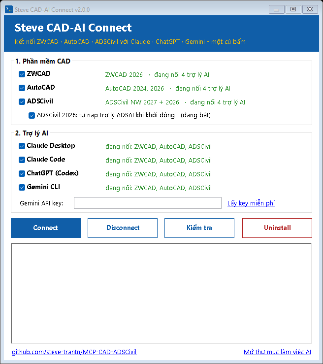

# Steve CAD-AI Connect

**Kết nối ZWCAD · AutoCAD · ADSCivil với Claude · ChatGPT · Gemini bằng một cú bấm.**

Sau khi kết nối, bạn chỉ cần trò chuyện với trợ lý AI và nó sẽ **điều khiển trực tiếp phần mềm CAD đang mở**: đọc layer và đối tượng, vẽ, sửa, chèn block, chạy lệnh, tra tiêu chuẩn TCVN (với ADSCivil)... Việc kết nối dùng **MCP** (Model Context Protocol).



> **Liên hệ hỗ trợ:** Steve Tran | 0987 779 228

## Dùng thế nào

1. **Tải về:** vào trang [**Releases**](https://github.com/steve-trantn/MCP-CAD-ADSCivil/releases/latest), tải file `Steve-CAD-AI-Connect-*.zip` rồi giải nén.
2. **Bấm đúp `Steve CAD-AI Connect.cmd`.**
3. **Tích chọn** phần mềm CAD và trợ lý AI muốn nối, rồi bấm **Connect**.
4. **Thoát hẳn trợ lý AI rồi mở lại** và bắt đầu ra lệnh, ví dụ: *"Bản vẽ đang mở có những layer nào?"*, *"Vẽ hình chữ nhật 1000×500 trên layer AI-TEST"*.

Câu hỏi để thử (ZWCAD, AutoCAD):

| Mục đích | Câu hỏi |
|---|---|
| Đọc | "Bản vẽ có những layer nào, mỗi layer bao nhiêu đối tượng?" |
| Tính | "Tính tổng chiều dài và diện tích các polyline đang chọn." |
| Đếm | "Đếm số lượng từng loại block trong bản vẽ." |
| Dọn | "Tìm các đối tượng bị trùng trên layer 0 (chưa xoá)." |
| Vẽ | "Tạo layer AI-TEST màu đỏ, vẽ hình chữ nhật 1000×500 tại gốc toạ độ rồi ghi kích thước các cạnh." |
| Sửa | "Chuyển các text đang chọn sang layer TEXT màu vàng." |
| Xem | "Chụp màn hình và cho biết bản vẽ đang có gì." |
| 3D | "Dựng cống 3D từ bản vẽ này: cao độ đáy đầu vào 3.31, đầu ra 3.25, tuyến cống hướng 30°." |
| IFC | "Đặt cống về toạ độ X=..., Y=..., góc 30°, đặt layer theo tên cống và lý trình rồi xuất IFC 4.3." |
| PDF | "Đọc bản vẽ cống trong D:\cong.pdf và dựng mô hình 3D." |

Kết nối xong có thể đóng công cụ, khởi động lại máy cũng không mất kết nối. Công cụ tạo shortcut **Steve CAD-AI Connect** trên Desktop và trong Start menu để mở lại khi cần.

| Muốn | Làm |
|---|---|
| Ngắt kết nối | Mở công cụ, tích chọn mục muốn ngắt, bấm **Disconnect** |
| Kiểm tra | Mở phần mềm CAD, bấm **Kiểm tra**: công cụ đọc thử danh sách layer của bản vẽ đang mở |
| Gỡ bỏ | Bấm **Uninstall**, hoặc chạy `Uninstall.cmd`, hoặc vào *Settings → Apps → Steve CAD-AI Connect → Uninstall* |

> Windows SmartScreen có thể cảnh báo khi chạy file tải từ Internet: bấm **More info → Run anyway**.

## Phần mềm CAD hỗ trợ

| CAD | MCP server | Yêu cầu | Chi tiết |
|---|---|---|---|
| **ZWCAD** | **Steve CAD MCP** (viết riêng, [server/](server)), 63 tool | ZWCAD 2020+; Python tự cài nếu thiếu | [CAD/ZWCAD](CAD/ZWCAD) |
| **AutoCAD** | **Steve CAD MCP**, cùng 63 tool | AutoCAD 2018+ (bản đầy đủ, không phải LT) | [CAD/AutoCAD](CAD/AutoCAD) |
| **ADSCivil** | `AdsMcpServer.exe` có sẵn trong ADSCivil 2027, khoảng 290 tool nghiệp vụ | ADSCivil NW 2027 For ZWCAD 2026 | [CAD/ADSCivil](CAD/ADSCivil) |

Máy có phần mềm nào thì ô đó mới bật. Nối nhiều CAD cùng lúc được: mỗi CAD là một server riêng (`zwcad`, `autocad`, `adscivil`).

**Steve CAD MCP (ZWCAD, AutoCAD) có gì:**

- **Gom UNDO:** mỗi lần AI sửa bản vẽ là **một** bước UNDO.
- **Ghim bản vẽ:** đổi tab giữa chừng thì AI không vẽ nhầm sang bản vẽ khác.
- **Lọc ngay trong CAD:** bản vẽ lớn vẫn đọc nhanh.
- **Đọc đối tượng đang chọn:** AI biết "các đối tượng này" là gì.
- **Tool tính toán:** chiều dài, diện tích, đếm block, tìm đối tượng trùng nhau.
- **Ghi kích thước tự động** cho mọi cạnh.
- **Chụp màn hình:** AI tự xem kết quả đã vẽ.
- **Dựng 3D:** mặt cắt trong bản vẽ được đưa lên đúng hướng tuyến, góc chéo, cao độ, độ dốc rồi đùn thành khối solid. Các khối cộng, trừ, giao và cắt chéo được.
- **Toạ độ thật, layer tự động, xuất IFC4 / IFC4.3:** đưa mô hình về toạ độ công trình; đặt layer theo tên cống + lý trình + bộ phận; xuất IFC có thông tin phi hình học (công trình, lý trình, bộ phận, vật liệu, khối lượng).
- **Đọc PDF:** xem trang PDF như ảnh, hoặc nhập nét vẽ vector vào bản vẽ.
- **Đọc chữ font TCVN3/VNI:** chữ trong bản vẽ cũ được giải mã sang Unicode.
- **Skill:** quy trình làm sẵn cho việc nhiều bước. Hiện có **`cong-3d`**: dựng cống 3D (thân cống, tường đầu, tường cánh, sân cống...) từ bản vẽ DWG/PDF, mỗi bộ phận một màu.
- **Báo lỗi tiếng Việt:** báo rõ khi CAD đang bận hoặc bị hộp thoại chặn.

Chi tiết: [server/README.md](server/README.md).

## Trợ lý AI hỗ trợ

| Trợ lý | Cần gì | Ghi chú |
|---|---|---|
| **Claude Desktop** | [Claude Desktop](https://claude.ai/download), đăng nhập | Hỗ trợ cả bản Microsoft Store và bản cài thường |
| **Claude Code** | Claude Code | Nối ở phạm vi user, dùng được ở mọi thư mục |
| **ChatGPT (Codex)** | App **Codex** (Microsoft Store), đăng nhập ChatGPT | Mở thư mục làm việc `Steve-CAD-AI` trong Codex |
| **Gemini CLI** | **API key** miễn phí tại <https://aistudio.google.com/apikey> | Công cụ tự cài Node.js và Gemini CLI. Dán key vào ô *Gemini API key*. Mở bằng shortcut **Gemini CAD AI** |

ChatGPT bản web không dùng được vì chỉ nhận MCP server từ xa qua HTTPS.

## Công cụ làm gì trên máy

- **ZWCAD, AutoCAD:** chép Steve CAD MCP vào `%LOCALAPPDATA%\SteveCADConnect\server` và tạo môi trường Python riêng (thư viện `mcp`, `pywin32`, `pillow`). Server chỉ nói chuyện với CAD qua COM, không gửi dữ liệu ra ngoài.
- **Cho AI chạy script (tuỳ chọn, mặc định tắt):** ô *"cho AI chạy script Python"* bật tool `run_script` để AI xử lý hàng loạt. AI sẽ tự chạy mã trên máy, nên chỉ bật khi cần.
- **Đăng ký server** vào cấu hình của từng trợ lý AI đã chọn. Mọi file cấu hình được sao lưu trước khi sửa (`*.bak-<thời gian>`).
- **Tạo thư mục làm việc** `%USERPROFILE%\Steve-CAD-AI` với lời dặn cho AI (`AGENTS.md`, `CLAUDE.md`, `GEMINI.md`): luôn đọc bản vẽ thật bằng tool, hỏi trước khi xóa, lưu hoặc đóng bản vẽ.
- **ADSCivil 2026** (tùy chọn): chép trợ lý AI của bản 2027 sang và cho nó tự nạp khi khởi động (lệnh `ADSAI`). Chỉ xin quyền admin khi cần.
- **Uninstall** gỡ sạch tất cả: ngắt kết nối, tắt tự nạp, xóa server, shortcut và mục trong Settings → Apps. Riêng thư mục làm việc (có API key) được giữ lại.

## Dòng lệnh (cho IT, cài hàng loạt)

```bat
powershell -ExecutionPolicy Bypass -File app\SteveCADConnect.ps1 -Connect                 :: moi CAD + moi tro ly co tren may
powershell -ExecutionPolicy Bypass -File app\SteveCADConnect.ps1 -Connect -Cad zwcad -Client codex,claude -Test
powershell -ExecutionPolicy Bypass -File app\SteveCADConnect.ps1 -Connect -Ads2026 -GeminiKey <key>
powershell -ExecutionPolicy Bypass -File app\SteveCADConnect.ps1 -Connect -Cad zwcad -AllowScript   :: bat run_script
powershell -ExecutionPolicy Bypass -File app\SteveCADConnect.ps1 -Disconnect -Cad autocad
powershell -ExecutionPolicy Bypass -File app\SteveCADConnect.ps1 -Uninstall
```

## Xử lý sự cố

| Hiện tượng | Cách xử lý |
|---|---|
| AI trả lời "không xem được màn hình", không thấy dòng gọi tool (`zwcad/...`, `adscivil/...`) | Thoát hẳn trợ lý AI rồi mở lại, mở cuộc trò chuyện mới. Codex: mở thư mục `Steve-CAD-AI`. Log lỗi Codex nằm ở `%USERPROFILE%\.codex\logs_2.sqlite` |
| Gemini: `IneligibleTierError` | Dùng API key, không đăng nhập Google |
| Gemini: server bị `Disabled` | Mở Gemini bằng shortcut **Gemini CAD AI** (thư mục đã đánh dấu tin cậy) |
| Kiểm tra báo "chưa đọc được bản vẽ" | Mở CAD và một bản vẽ, bấm Esc để thoát lệnh hoặc hộp thoại đang mở, rồi thử lại |
| ADSCivil: "Cannot reach ADSCivil" | Mở ADSCivil (không phải ZWCAD thường) và một bản vẽ |
| Mở nhiều phiên CAD cùng lúc | Server nối vào phiên mà Windows đăng ký trước. Nên chỉ mở một phiên |
| AI báo CAD "bị chặn bởi hộp thoại" | Đóng hộp thoại đang mở trong CAD (ví dụ hộp thoại bản quyền của AutoCAD), rồi thử lại |
| Vẫn chưa được | Liên hệ **Steve Tran, 0987 779 228** |

## Cấu trúc

```
Steve CAD-AI Connect.cmd    bấm đúp để mở công cụ
Uninstall.cmd               gỡ toàn bộ
app/                        SteveCADConnect.ps1 (giao diện + dòng lệnh), core.ps1
CAD/ZWCAD/                  lời dặn AI cho ZWCAD
CAD/AutoCAD/                lời dặn AI cho AutoCAD
server/                     Steve CAD MCP (ZWCAD, AutoCAD)
CAD/ADSCivil/               lời dặn AI, tự nạp ADSCivil 2026 (ads-ai-autoload.lsp, install-2026-autoload.ps1)
templates/                  lời dặn chung, launcher Gemini
```

## Liên hệ

**Steve Tran** · 0987 779 228 · [github.com/steve-trantn](https://github.com/steve-trantn)

Báo lỗi hoặc góp ý: gọi trực tiếp, hoặc mở [Issue](https://github.com/steve-trantn/MCP-CAD-ADSCivil/issues) trên GitHub.

## Bản quyền

- Steve CAD MCP (thư mục `server/`) © Steve Tran.
- ADSCivil và `AdsMcpServer.exe` thuộc bản quyền của nhà phát triển ADSCivil. Repo không chứa file nào của ADSCivil; công cụ dùng bản đã cài trên máy.
